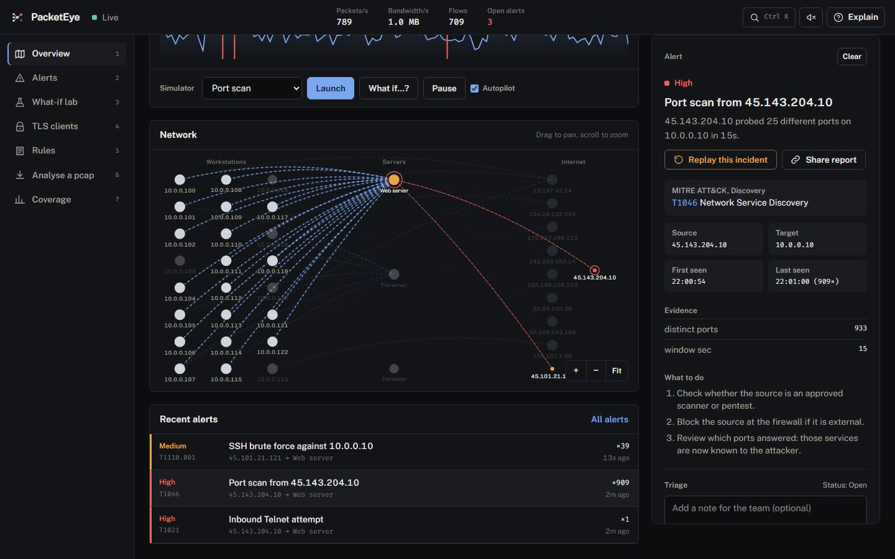
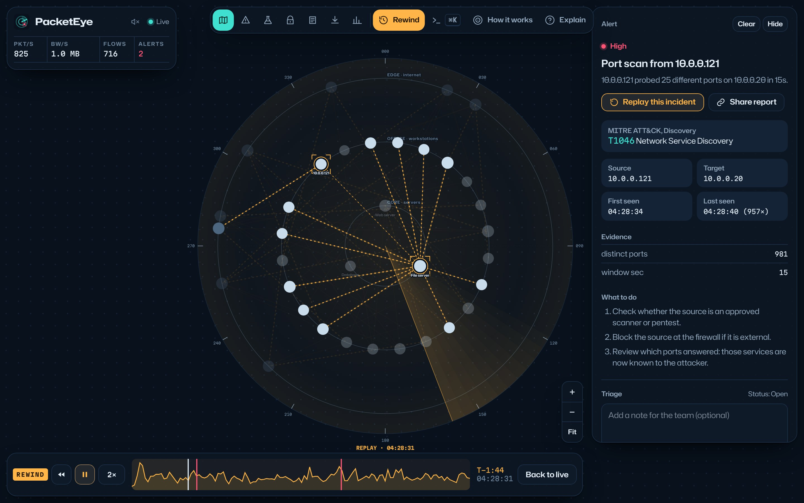
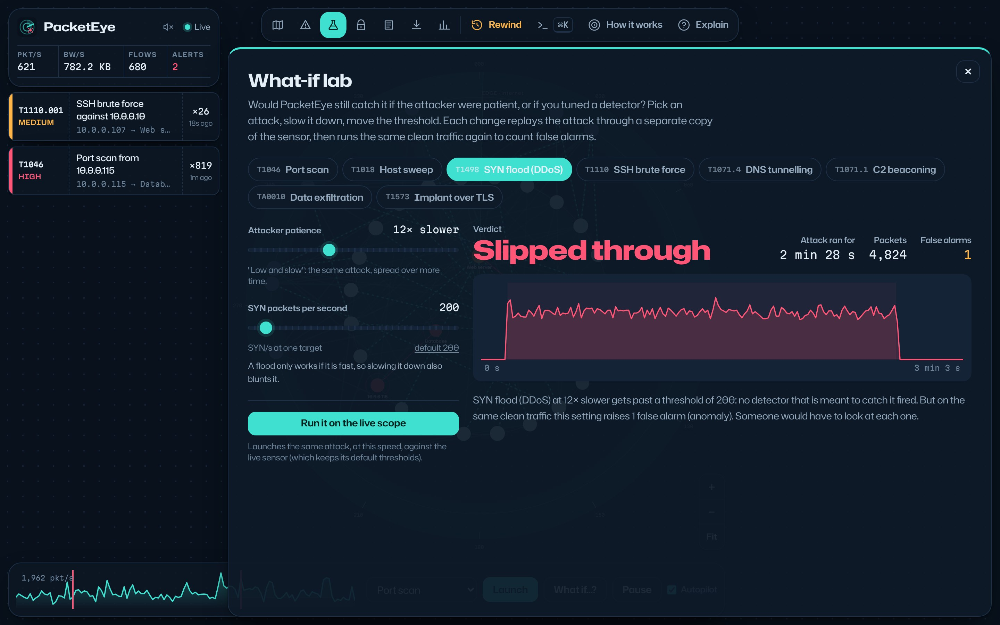
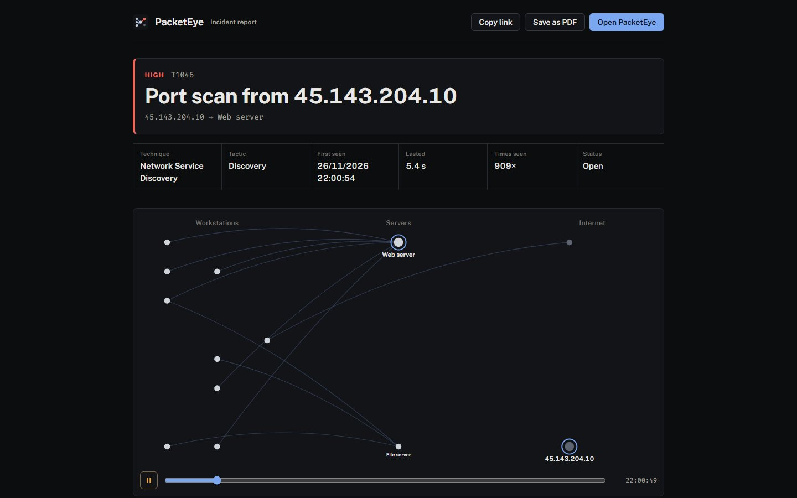
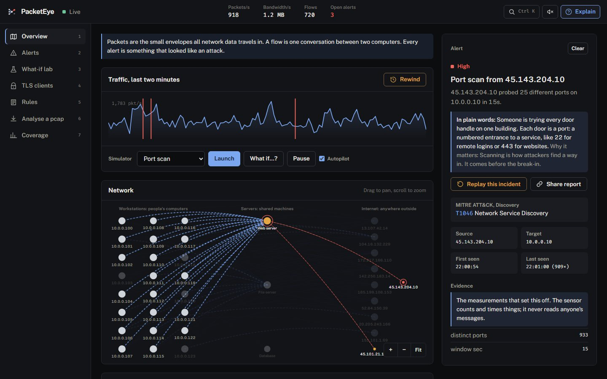
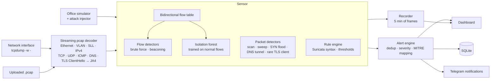
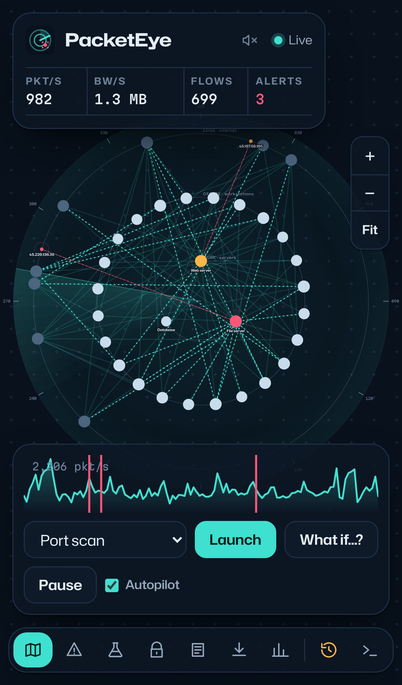

<p align="center">
  
</p>

# PacketEye · Network intrusion detection

Real-time intrusion detection that runs in your browser: behaviour detectors, Suricata-syntax rules, JA4 TLS fingerprints and an unsupervised model in one sensor. Live demo: **[packeteye.vercel.app](https://packeteye.vercel.app)**. No sign-up, and no data leaves your machine.



## The problem

Intrusion detection buries people in log lines. The row that matters hides among thousands, and only experts can read it. Suricata, Zeek and Snort are excellent sensors, but they leave you with logs and a separate dashboard.

PacketEye never reads message contents. It watches who talks to whom, how often, how much, how regularly, and how each app says hello. Attacks have a shape even when they are encrypted. Every alert comes with evidence and next steps, and you can replay it, test it against a patient attacker, read it in plain words and share it as a link.

## What it does

Everything below works in the live demo. <kbd>Ctrl</kbd>+<kbd>K</kbd> (or <kbd>/</kbd>) opens the command menu anywhere.

| Feature | What it does | Where |
| --- | --- | --- |
| **Overview** | Live packets, bandwidth, flows and open alerts; two minutes of traffic; the network map (workstations, servers, internet in fixed columns); recent alerts; an inspector for the selected alert or host. | <kbd>1</kbd> |
| **Alerts** | Every alert, filtered by status and severity, with triage (acknowledge, resolve, reopen) and notes. Repeats fold into one row with a count. | <kbd>2</kbd> |
| **Rewind** | The recorder keeps one frame a second for five minutes. Play any incident back on the map, scrub, step 10 s, change speed. Playback is marked in amber. | **Replay this incident**, **Rewind**, <kbd>R</kbd>, or click the traffic chart |
| **What-if lab** | Slow an attacker down up to 30×, move a detector's threshold. Each change replays the attack through an isolated copy of the sensor (in a worker) and runs clean traffic again, so you see whether it is still caught, how fast, and the false alarms the setting costs. | <kbd>3</kbd> or **What if…?** |
| **TLS clients** | Every JA4 fingerprint on the network, rarest first. | <kbd>4</kbd> |
| **Rules** | Edit the Suricata-syntax ruleset; bad rules are rejected with their line number. | <kbd>5</kbd> |
| **Analyse a pcap** | Drop a capture (up to 50 MB); it is analysed in your browser. | <kbd>6</kbd> |
| **Coverage** | Detection rates on simulated attacks and on the public NSL-KDD benchmark. | <kbd>7</kbd> |
| **Shareable report** | One alert as a standalone page: severity, MITRE ATT&CK, evidence, response steps, notes and a playable map of the incident. The report lives in the link's `#fragment`, which never reaches a server. | **Share report** on any alert |
| **Explain like I'm new** | Plain-language notes next to everything technical. | **Explain**, <kbd>E</kbd>, or `?explain` in the link |
| **Alert sound** | A short chime for each new alert, higher for worse alerts. Off by default. | Speaker button, <kbd>M</kbd> |

| Rewind | What-if lab |
| --- | --- |
|  |  |

| Shared incident report | Explain like I'm new |
| --- | --- |
|  |  |

## How it works



No single method is enough: an implant over TLS looks like a normal web request to the anomaly model, but its JA4 fingerprint is used by one host only, so the rare-TLS-client detector catches it.

### Detectors

| Detector | How it works |
| --- | --- |
| Port scan | Distinct ports probed on one host by one source in a 15 s sliding window |
| Host sweep | Distinct hosts contacted on one port in 30 s |
| SYN flood | SYN rate per target plus the share of half-open handshakes. Counts spoofed sources, so a distributed attack becomes one critical alert. |
| Brute force | Short-lived connections to SSH, RDP, FTP, Telnet, database or VNC ports, per source and target |
| DNS tunnelling | Queries per registered domain, uniqueness, Shannon entropy and length of subdomains |
| Beaconing | Coefficient of variation of the gaps between connections to one external endpoint |
| Rare TLS client | Each TLS ClientHello is turned into a JA4 fingerprint (FoxIO specification, checked against its published example). Browsers and system services are shared by many hosts; a fingerprint used by fewer than three hosts, talking to the internet, raises an alert. It needs no signatures and survives encryption and randomised timing. |
| Rules | Suricata-syntax signatures on addresses, ports, TCP flags, DNS names, TLS server names and JA4 (`dns.query`, `tls.sni`, `ja4.hash`), with `threshold` and `detection_filter`. Unsupported keywords are rejected with their line number, never ignored. |
| Anomaly | An isolation forest (written from scratch) over 10 flow features, trained only on normal traffic, so it needs no labels and can flag unseen behaviour |


Repeats are grouped into one alert with a running count, so a 5,000-packet flood is one alert, not 5,000.

## Interface

One dark theme, Public Sans and Fira Code. A top bar with live figures, tools down the side (a bottom bar on phones), and motion only where it shows traffic direction, off under reduced motion. In the demo the sensor runs in a Web Worker, so the page stays responsive.

<p align="center"></p>

## Measured detection

`npm run evaluate` replays **60 minutes of labelled office traffic (3.0 million packets)** with 32 scheduled attacks, then scores every detector on two things: whether it fired, and how fast.

| Attack | MITRE ATT&CK | Detected | Mean time to detect |
| --- | --- | --- | --- |
| Port scan | T1046 | 4/4 | 0.1 s |
| Host sweep | T1018 | 4/4 | 0.5 s |
| SYN flood / DDoS (spoofed sources) | T1498.001 | 4/4 | 1.0 s |
| SSH brute force | T1110.001 | 4/4 | 11.5 s |
| DNS tunnelling | T1071.004 | 4/4 | 7.5 s |
| C2 beaconing | T1071.001 | 4/4 | 51.8 s |
| Data exfiltration (anomaly model) | TA0010 | 4/4 | 59.7 s |
| Implant over TLS with randomised sleep (JA4) | T1573 | 4/4 | first handshake |

- On clean background traffic it raises **0 false alerts per hour**, with the default ruleset loaded.
- One CPU core handles about **240,000 packets per second (4.0 µs per packet)**. That covers decoding, TLS fingerprinting, flow tracking, all detectors and the rules.
- A second seed gives the same coverage, so the results do not depend on one lucky run.

Beaconing and exfiltration are judged on whole connections, so they fire when the pattern or flow completes. The packet-level detectors fire within seconds.

The traffic is simulated, so these numbers measure the detectors against known patterns, not against every real network. The simulator includes legitimate look-alikes, such as long admin SSH sessions, big file-server transfers and bursts of normal DNS.

## Benchmark on a public dataset

The simulator above measures the detectors against known patterns. To measure the learning parts on traffic nobody here wrote, `npm run benchmark` uses **NSL-KDD**, a public intrusion-detection dataset. It trains on `KDDTrain+` (125,973 connection records) and scores on the official held-out file `KDDTest+` (22,544 records). The held-out file includes 3,750 records from 17 attack types that **never appear in training**. The files are downloaded on the first run (about 23 MB, no login), checked against pinned SHA-256 hashes, and are not committed. Results are written to [`reports/nsl-kdd.json`](reports/nsl-kdd.json).

**Random forest** (written from scratch in TypeScript: 60 trees over the 41 connection features), scored per class on `KDDTest+`:

| Class | Test records | Precision | Recall | False-positive rate |
| --- | --- | --- | --- | --- |
| Normal | 9,711 | 64.7% | 97.4% | 40.1% |
| DoS | 7,460 | 96.2% | 80.1% | 1.6% |
| Probe | 2,421 | 86.6% | 60.4% | 1.1% |
| R2L (remote to local) | 2,885 | 96.9% | 1.1% | 0.0% |
| U2R (user to root) | 67 | 66.7% | 3.0% | 0.0% |

Overall accuracy is 75.1%. Of the attack types never seen in training, 22.2% of records are flagged as some kind of attack. The false-positive rate for "normal" is high because 40.1% of attack records (5,150) are called normal. Over half of those (2,915) are R2L and U2R records, and most of the rest are DoS and probe variants missing from the training file. R2L and U2R attacks look like ordinary logins and file transfers at the connection level. Signatures, brute-force counting and fingerprinting are better at catching them than per-connection statistics.

**Isolation forest**: the same code as the sensor's anomaly detector. It is trained only on normal records and never sees an attack label. Its threshold is fixed beforehand at the 99th percentile of its scores on normal training data.

| Attack records flagged | Overall precision | Overall recall | False-positive rate on normal |
| --- | --- | --- | --- |
| DoS 72.5% · Probe 75.4% · R2L 0.5% · U2R 17.9% | 98.8% | 56.5% | 0.9% |

That is a 0.9% false-alarm rate with no labels, but it misses most attacks that look like normal sessions. This is why PacketEye puts behavioural detectors, rules and JA4 next to the anomaly model, instead of relying on it alone.

Dataset licence: NSL-KDD is published by the Canadian Institute for Cybersecurity (University of New Brunswick) for research use, citing M. Tavallaee, E. Bagheri, W. Lu and A. Ghorbani, "A Detailed Analysis of the KDD CUP 99 Data Set", IEEE CISDA 2009. It has no open-source licence, so it is downloaded at run time from a public mirror and never stored in this repository. Its traffic is from 1998, so treat these numbers as a reproducible baseline, not as a prediction for a modern network.

## Run it

You need Node 22.13 or newer. From a copy of the repository:

```bash
npm install
npm run build && npm start        # http://localhost:8080 (simulator mode)
```

For development with hot reload, run `npm run dev`. It starts the API on port 8080 and the dashboard on 5174.

**Monitor a real interface** (Linux, needs `tcpdump` and raw-socket permission):

```bash
sudo CAPTURE_INTERFACE=eth0 npm start
# or with Docker
docker build -t packeteye .
docker run --network host --cap-add NET_RAW -e CAPTURE_INTERFACE=eth0 packeteye
```

**Telegram alerts:** set `TELEGRAM_BOT_TOKEN` and `TELEGRAM_CHAT_ID`. High and critical alerts are then sent, at most once per minute per alert type.

**Reproduce the evaluation:**

```bash
npm run evaluate                  # SEED=21 MINUTES=45 npm run evaluate
npm run benchmark                 # NSL-KDD public dataset, about 70 s on one core
```

### API

| Method | Path | Description |
| --- | --- | --- |
| `GET` | `/api/history` | The recorder: one frame a second for the last five minutes (used by Rewind) |
| `GET` | `/api/ws` | WebSocket: stats every second, plus alerts as they fire |
| `GET` | `/api/alerts`, `PATCH /api/alerts/:id` | List and filter alerts, or triage one (status and note) |
| `POST` | `/api/pcap` | Analyse an uploaded capture (multipart `file`) |
| `GET` | `/api/pcap/sample` | Download a sample capture with every attack type |
| `GET` | `/api/stats`, `/api/evaluation`, `/api/config` | Traffic stats, coverage report and detector thresholds |
| `GET` | `/api/tls` | TLS fingerprint inventory: JA4, hosts, server names, profile |
| `GET` | `/api/rules`, `PUT /api/rules` | Read the ruleset with hit counts, or replace it (`{"text": "..."}`). Invalid rules return 400 with line numbers. |
| `POST` | `/api/attacks` | Launch a simulated attack: `{"kind": "port_scan", "stretch": 10}` (`stretch` slows the attacker down, 1 to 30) |
| `POST` | `/api/attacks`, `PUT /api/live`, `PUT /api/config`, `PUT /api/rules` | Simulation, tuning and rules. Protected by `ADMIN_TOKEN` when set. |

## Live demo on Vercel

`npm run build:demo` builds the app with the sensor compiled into the browser: the simulated office network, flow table, all detectors and the isolation forest run client-side in a Web Worker, and uploaded captures are analysed locally. Vercel picks up `vercel.json`; no settings or environment variables are needed. Live capture from a real interface and Telegram alerts need the full server (`npm start` or Docker).


## Tests

```bash
npm run lint && npm run typecheck
npm test         # 68 unit tests
npm run test:e2e # 14 browser tests on the demo build
```

The unit tests cover pcap round trips (chunked streaming, VLAN tags, snap length), the flow handshake, every detector on clean and attack traffic, alert grouping, the evaluation harness, the recorder, the what-if lab (a slowed flood slips through; a low threshold raises false alarms), the report link codec, and the API (upload, triage, admin protection, input validation, history).

The browser tests run every feature end to end: every tool, a launched attack detected and explained, a host selected on the map, Rewind replaying an incident and scrubbing, the what-if lab, explain mode, a shared report link opening on its own, the command menu with the alert sound, the sample pcap, rule validation, the NSL-KDD coverage, reduced motion and phone width.

## Responsible use

Only monitor networks you own or are authorised to monitor. The attack simulator generates synthetic packets inside the app, and it never sends traffic to a real network.

## Tech stack

TypeScript · Node.js 22 · Fastify · WebSocket · node:sqlite · Zod · React 19 · Vite · Tailwind CSS 4 · Web Workers · Vitest · Playwright · Docker

## License

MIT
