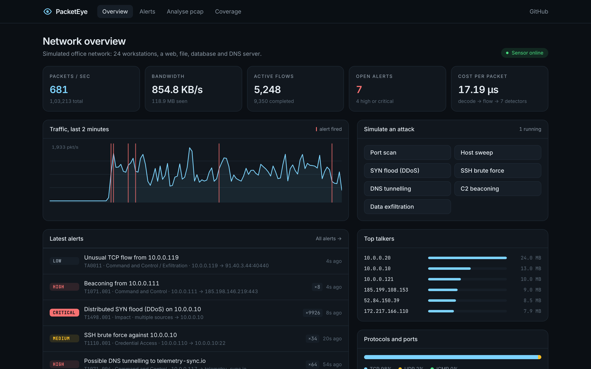
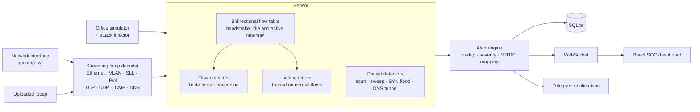
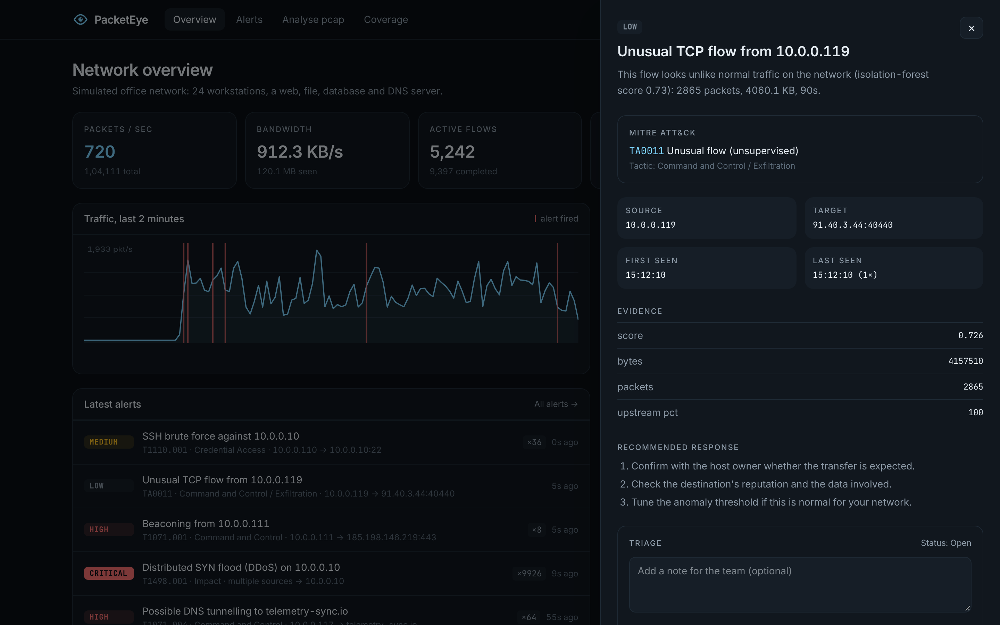
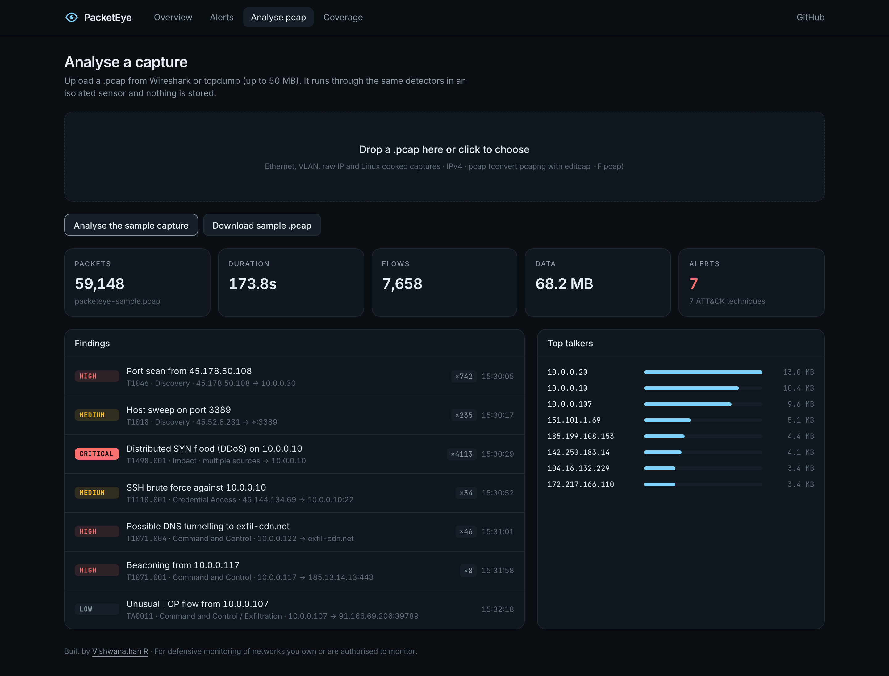
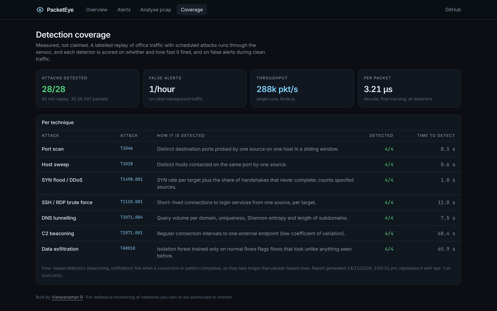
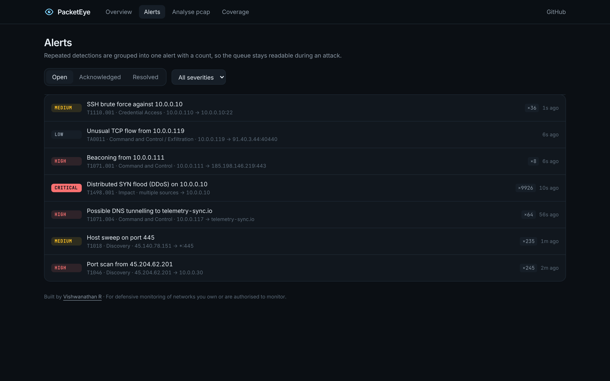

# PacketEye · Real-time network intrusion detection

> Built by [Vishwanathan R](https://vishwanathan.dev) · [Portfolio](https://vishwanathan.dev) · [Resume](https://vishwanathan.dev/resume.pdf)

PacketEye watches network traffic, rebuilds every connection, and raises alerts for real attack techniques. Each alert is mapped to **MITRE ATT&CK** and comes with evidence and recommended response steps. It can work from:
- live traffic, captured through `tcpdump`
- an uploaded Wireshark or tcpdump capture (`.pcap`)
- a built-in office-network simulator, which can launch attacks on demand

It is built **end to end in TypeScript**: a dependency-free pcap parser, flow tracking, seven detectors, an unsupervised anomaly model, a Node.js API and a React dashboard.



> Version 2 is a full rebuild. The original Python, Spring Boot and React version is kept on the [`v1-original`](https://github.com/Vishwanathanirv/real-time-intrusion-detection-system-main/tree/v1-original) branch.

## Measured detection

`npm run evaluate` replays **60 minutes of labelled office traffic (3.0 million packets)** with 28 scheduled attacks, then scores every detector on two things: whether it fired, and how fast.

| Attack | MITRE ATT&CK | Detected | Mean time to detect |
| --- | --- | --- | --- |
| Port scan | T1046 | 4/4 | 0.1 s |
| Host sweep | T1018 | 4/4 | 0.6 s |
| SYN flood / DDoS (spoofed sources) | T1498.001 | 4/4 | 1.0 s |
| SSH brute force | T1110.001 | 4/4 | 11.0 s |
| DNS tunnelling | T1071.004 | 4/4 | 7.5 s |
| C2 beaconing | T1071.001 | 4/4 | 68.4 s |
| Data exfiltration (anomaly model) | TA0010 | 4/4 | 65.9 s |

- On clean background traffic it raises **1 false alert per hour**.
- One CPU core handles about **288,000 packets per second (3.2 µs per packet)**. That covers decoding, flow tracking and all seven detectors.
- A second seed gives the same coverage, so the results do not depend on one lucky run.

Beaconing and exfiltration are judged on whole connections, so they fire when the pattern or flow completes. The packet-level detectors fire within seconds.

The traffic is simulated, so these numbers measure the detectors against known patterns, not against every real network. The simulator includes legitimate look-alikes, such as long admin SSH sessions, big file-server transfers and bursts of normal DNS.

## How it works



| Detector | How it works |
| --- | --- |
| Port scan | Distinct ports probed on one host by one source in a 15 s sliding window |
| Host sweep | Distinct hosts contacted on one port in 30 s |
| SYN flood | SYN rate per target plus the share of half-open handshakes. Counts spoofed sources, so a distributed attack becomes one critical alert. |
| Brute force | Short-lived connections to SSH, RDP, FTP, Telnet, database or VNC ports, per source and target |
| DNS tunnelling | Queries per registered domain, uniqueness, Shannon entropy and length of subdomains |
| Beaconing | Coefficient of variation of the gaps between connections to one external endpoint |
| Anomaly | An isolation forest (written from scratch) over 10 flow features, trained only on normal traffic, so it needs no labels and can flag unseen behaviour |

Repeated hits are grouped into one alert with a running count, so a 5,000-packet flood is one row in the queue, not 5,000.

## Dashboard

- **Overview:**
  - live packets per second, bandwidth, active flows and open alerts
  - a two-minute traffic chart with alert markers
  - top talkers, protocol mix and top ports
  - one-click attack simulation
- **Alerts:** a triage queue (open, acknowledged, resolved) with severity filters. Each alert shows its MITRE technique, evidence, recommended response steps and analyst notes.
- **Analyse pcap:** drop in a capture of up to 50 MB and get findings, flows and top talkers. A sample capture containing every attack type is built in.
- **Coverage:** the evaluation report above, generated from the code.

| Alert detail | Analyse a capture |
| --- | --- |
|  |  |

| Detection coverage | Alert queue |
| --- | --- |
|  |  |

## Run it

You need Node 22.13 or newer.

```bash
git clone https://github.com/Vishwanathanirv/real-time-intrusion-detection-system-main.git
cd real-time-intrusion-detection-system-main
npm install
npm run build && npm start        # http://localhost:8080 (simulator mode)
```

For development with hot reload, run `npm run dev`. It starts the API on port 8080 and the dashboard on 5174.

**Monitor a real interface** (Linux, needs `tcpdump` and raw-socket permission):

```bash
sudo CAPTURE_INTERFACE=eth0 npm start
# or with Docker
docker build -t packeteye .
docker run --network host --cap-add NET_RAW -e CAPTURE_INTERFACE=eth0 packeteye
```

**Telegram alerts:** set `TELEGRAM_BOT_TOKEN` and `TELEGRAM_CHAT_ID`. High and critical alerts are then sent, at most once per minute per alert type.

**Reproduce the evaluation:**

```bash
npm run evaluate                  # SEED=21 MINUTES=45 npm run evaluate
```

### API

| Method | Path | Description |
| --- | --- | --- |
| `GET` | `/api/ws` | WebSocket: stats every second, plus alerts as they fire |
| `GET` | `/api/alerts`, `PATCH /api/alerts/:id` | List and filter alerts, or triage one (status and note) |
| `POST` | `/api/pcap` | Analyse an uploaded capture (multipart `file`) |
| `GET` | `/api/pcap/sample` | Download a sample capture with every attack type |
| `GET` | `/api/stats`, `/api/evaluation`, `/api/config` | Traffic stats, coverage report and detector thresholds |
| `POST` | `/api/attacks`, `PUT /api/live`, `PUT /api/config` | Simulation and tuning. Protected by `ADMIN_TOKEN` when set. |

## Tests

```bash
npm run lint && npm run typecheck
npm test     # 27 tests
```

The tests cover:
- pcap round trips, including chunked streaming, VLAN tags and snap length
- the flow handshake
- every detector, on both clean and attack traffic
- grouping of repeated alerts
- the evaluation harness
- API upload and triage, admin protection and input validation
- the Telegram rate limit

## Responsible use

Only monitor networks you own or are authorised to monitor. The attack simulator generates synthetic packets inside the app, and it never sends traffic to a real network.

## Roadmap

- IPv6 and pcapng support
- Suricata-compatible rule import
- Exporting alerts as JSON or to a SIEM

## Tech stack

TypeScript · Node.js 22 · Fastify · WebSocket · node:sqlite · Zod · React 19 · Vite · Tailwind CSS 4 · Vitest · esbuild · Docker · GitHub Actions

## License

MIT © Vishwanathan R
